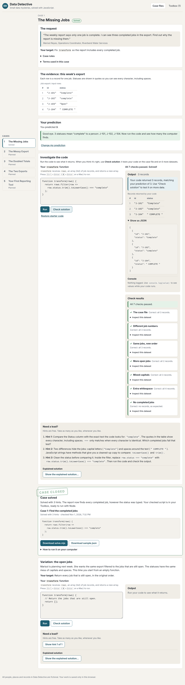

# Data Detective

A friendly learning app for writing useful workplace data scripts in JavaScript.

You play a data detective at a fictional water utility, Riverbend Water Services. Each case starts with a request from a colleague and a small dataset. You inspect the data, predict the answer, fix a real JavaScript function, run it, check it against more data, and finish with a Node script you can keep.

Milestone 1 (Case 1, **The Missing Jobs**) is complete. Cases 2–5 are planned; see [docs/PRODUCT.md](docs/PRODUCT.md) and [docs/STATUS.md](docs/STATUS.md).



## Run it locally

You need **Node.js 24 LTS**. This project was built and tested with **Node.js v24.22.1** (see [.nvmrc](.nvmrc)) and npm 11.

```bash
npm install
```

```bash
npm run dev
```

Then open the address Vite prints (usually http://localhost:5173/).

To try the production build, which has the full Content Security Policy:

```bash
npm run build
```

```bash
npm run preview
```

The app is static. After `npm run build`, the `dist/` folder can be served from any static web host, including from a sub-folder. It needs no backend, login, API key or paid service, and works offline once loaded.

## Checks

| Command | What it does |
| --- | --- |
| `npm run lint` | ESLint |
| `npm test` | Unit tests (Vitest): checking logic, saved progress, the exported Node script (run in a real Node process), the sandbox CSP and runner messaging |
| `npm run build` | Production build into `dist/` |
| `npm run test:e2e` | Browser tests (Playwright, Chromium) against the production build: the learner journey, keyboard use, a phone-sized screen, runner errors and recovery, and the isolation boundaries |
| `npm run check` | All of the above, in that order |

The browser tests expect Playwright's Chromium. In this repository `@playwright/test` is pinned to 1.63.0 to match the browser installed in the cloud environment; elsewhere, run `npx playwright install chromium` once.

## How it's organised

```
src/
  missions/       case content: requests, rules, datasets, hints, solutions
  checking/       turns run results into plain-language feedback
  runner/         the sandboxed code runner (app side + sandbox page scripts)
  storage/        saved progress in localStorage, with validation
  export/         builds the downloadable Node script and sample file
  components/     React UI
build/sandboxPage.js   builds sandbox.html and the app's CSP (Vite plugin)
tests/unit/       Vitest
tests/e2e/        Playwright
docs/             product scope, architecture, case notes, status
```

Each layer is separate, so later cases add a mission file and datasets without touching the runner. See [docs/ARCHITECTURE.md](docs/ARCHITECTURE.md) for how learner code is run and isolated, and its known limits.

## Adding a case (later milestones)

1. Add a mission file in `src/missions/` with its request, rules, rows, datasets with explicit expected IDs, hints and explained solution. Copy the shape of `missingJobs.js`.
2. Mark it `playable: true` in `src/missions/index.js`.
3. Document its datasets in `docs/cases/`.
4. Add unit tests that the expected results follow the case rules, and extend the browser journey.

Case 2 introduces CSV, which will need a parser and probably a different checker for rejected rows. See the backlog in [docs/PRODUCT.md](docs/PRODUCT.md).

## Privacy

Everything stays in your browser. Drafts and progress are saved in `localStorage` for this site only. All people, places and records are fictional.
