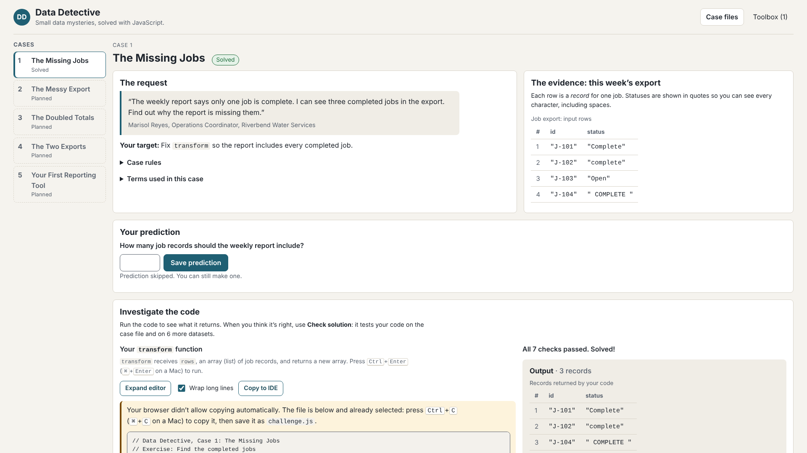

# Data Detective

A friendly learning app for writing useful workplace data scripts in JavaScript.

You play a data detective at a fictional water utility, Riverbend Water Services. Each case starts with a request from a colleague and a small dataset. You inspect the data, predict the answer, fix a real JavaScript function, run it, check it against more data, and retain the code that passed. Cases 1, 3, 4 and 5 provide standalone Node JSON tools; Case 2 provides a complete Node CSV reporting tool.

The app fills the browser window, with the case list as a compact sidebar on desktop. The editor can be expanded to full width, with optional word wrap. **Copy to IDE** copies the exercise as a runnable `challenge.js`, so learners can work in VS Code, VSCodium or another IDE and paste their solution back. For Case 2 this is explicitly a parsed-record exercise, using the displayed records; it does not read CSV files.

Milestone 1 (Case 1, **The Missing Jobs**) is complete and owner-approved. Milestone 2, **The Messy Export**, is feature-complete; its owner QA and final approval remain pending, deferred to November 14–15, 2026. Milestone 3, **The Doubled Totals**, is feature-complete with a browser mission and standalone JSON-file reporting tool: investigate copied and conflicting jobs, retain safe originals, produce an audit trail and verify a reliable hours subtotal. Its owner QA is also queued for November 14–15; approval remains pending. Milestone 4, **The Two Exports**, is feature-complete with an independently playable browser mission and standalone two-file Node reconciliation tool; owner QA remains pending, queued for November 14–15 if practical. Milestone 5 is feature-complete through Slice 2, including the browser capstone, independent variation and standalone three-input Node workflow. Owner QA/approval remains pending; see [docs/PRODUCT.md](docs/PRODUCT.md) and [docs/STATUS.md](docs/STATUS.md).



## Run it locally

You need **Node.js 24 LTS**. [.nvmrc](.nvmrc) pins **v24.22.1**. The final independent audit ran **v24.18.0 / npm 11.16.0**; the exact pinned patch was unavailable in that environment and still needs an owner check.

```bash
npm install
```

```bash
npm run dev
```

Then open the address Vite prints (usually http://localhost:5173/).

To try the production build, which has the full Content Security Policy:

```bash
npm run build
```

```bash
npm run preview
```

The app is static. After `npm run build`, the `dist/` folder can be served from any static web host, including from a sub-folder. It needs no backend, login, API key or paid service, and works offline once loaded.

## Checks

| Command | What it does |
| --- | --- |
| `npm run lint` | ESLint |
| `npm test` | Unit tests (Vitest): all five mission contracts/checkers, saved progress, exported tools run in real Node processes, the sandbox CSP and runner messaging, and CSV parsing |
| `npm run build` | Production build into `dist/` |
| `npm run test:e2e` | Browser tests (Playwright, Chromium) against the production build: the learner journey, keyboard use, a phone-sized screen, runner errors and recovery, and the isolation boundaries |
| `npm run check` | All of the above, in that order |

The browser suite starts its own production preview and refuses to reuse an unknown server. If port 4173 is occupied, use `DATA_DETECTIVE_TEST_PORT=4287 npm run check` (or another free port).

The browser tests expect Playwright's Chromium. In this repository `@playwright/test` is pinned to 1.63.0 to match the browser installed in the cloud environment; elsewhere, run `npx playwright install chromium` once.

## How it's organised

```
src/
  missions/       case content: requests, rules, datasets, hints, solutions
  csv/            CSV parsing (Papa Parse wrapper), shared by browser and Node
  checking/       turns run results into plain-language feedback
  runner/         the sandboxed code runner (app side + sandbox page scripts)
  storage/        saved progress in localStorage, with validation
  export/         builds the downloadable Node script and sample file
  components/     React UI
build/sandboxPage.js   builds sandbox.html and the app's CSP (Vite plugin)
tests/unit/       Vitest
tests/e2e/        Playwright
docs/             product scope, architecture, case notes, status
```

Each layer is separate, so cases add mission content, datasets and the appropriate checker/output presentation without changing the sandbox runner. See [docs/ARCHITECTURE.md](docs/ARCHITECTURE.md) for how learner code is run and isolated, and its known limits.

## Adding a case

1. Add a mission file in `src/missions/` with its request, rules, rows, datasets with explicit expected IDs, hints and explained solution. Copy the shape of `missingJobs.js`.
2. Add it to `src/missions/index.js`, mark it `playable: true`, and connect its investigation view and output/checker type.
3. Document its datasets in `docs/cases/`.
4. Add unit tests that the expected results follow the case rules, and extend the browser journey.

Case 2 introduces CSV. The contract, parser and datasets (Slice 1), `{ accepted, rejected }` checker (Slice 2), playable browser investigation (Slice 3), and standalone Node CSV workflow (Slice 4) are implemented. Use the sidebar to switch cases; hash URLs preserve location through Back, Forward and refresh. Each mission saves its own progress without resetting Case 1. Broken CSV examples stop the whole file before validation. See [docs/cases/02-messy-export.md](docs/cases/02-messy-export.md) and [docs/STATUS.md](docs/STATUS.md).

Case 3 is independently playable at `#/case/doubled-totals`; no Case 2 completion is needed. Use the exact string job ID as a key, compare business fields, and separate safe originals, linked exact duplicates and whole conflict groups. Only safely retained records contribute to the reliable subtotal. The lesson teaches Map, Set, grouping, equality, provenance and verification through 17 checking datasets. Prediction, hints, explained solution, editor controls and saved progress follow the earlier cases. Copy to IDE provides the current draft as a sample-data challenge; the Toolbox exports the last passing code with a real JSON-file runner. See [the Case 3 contract](docs/cases/03-doubled-totals.md).

## Investigate Case 4: The Two Exports

Open `#/case/two-exports` directly, or choose Case 4 in the sidebar. Sam needs a
reconciliation of scheduling and field operations for the same week. Inspect the
two source tables, predict agreeing pairs or skip, and write
`reconcile(orders, fieldReports)`. Both arrays are already parsed and validated.
Match exact string job IDs, compare site/status/planned versus actual hours,
preserve both originals, and report every occurrence once. Repeated IDs in
either source make the whole key ambiguous, with no arbitrary winner.

Return `{ agreed, onlyOrders, onlyFieldReports, differences, ambiguous, summary }`.
Run displays your actual report. Check solution verifies 20 diverse datasets,
including missing counterparts, reordered records, exact text IDs, duplicate
keys, empty exports and a future week. Hints and the explained solution teach
Map lookups, value comparisons, joins and independent reconciliation checks.
Saved progress and the Toolbox retain the last passing code after draft changes,
failed or cancelled checks and refresh. Copy to IDE runs your current draft on
the two displayed sample arrays as `node challenge.js`; it contains no hidden
fixtures or automatic reference solution. The Toolbox downloads the last passing
solution as a standalone two-file Node tool described below. See [the exact Case 4 contract](docs/cases/04-two-exports.md).

## Investigate Case 5: Your First Reporting Tool

Open `#/case/first-reporting-tool`. Sam needs a trustworthy weekly operations
report from raw parsed work orders and field-time entries. Write
`buildWeeklyReport(rawOrders, rawEntries, period)` to clean, validate, distinguish
copies from conflicts, match jobs, select inclusive dates and group reliable
hours by site and day. Every original stays in an inspectable audit trail.

Run displays your actual report. Check verifies all **32 scenarios**, using
handwritten expectations for original preservation, cleaning, reasons,
classification, links, grouping, exact hundredths, ordering and full accounting.
Optional hints progress by stage; the explained solution requires confirmation.
The **Independent variation** offers a different future-week handover with less
scaffolding and separately saved drafts, hints, reveals and passing code.

Copy to IDE runs the active sample and period with the current draft. The
Toolbox exports each exercise's exact last passing code as a complete standalone
Node tool. Main and variation packages have their own displayed data and period. See [the full contract](docs/cases/05-first-reporting-tool.md)
and [current verification](docs/ENGINEERING-REVIEW.md). Cases 2–4 still await
owner QA November 14–15, 2026; no approval is inferred from this implementation.

## Use your Case 5 weekly reporting tool

Pass all 32 checks in either investigation, then download **all five files** into
one new folder: `weekly-report.mjs`, `orders.json`, `entries.json`, `period.json`,
`README.md`. Keep main and variation packages in separate folders. With Node 24:

```bash
node weekly-report.mjs orders.json entries.json period.json
node weekly-report.mjs orders.json entries.json period.json report.json
node weekly-report.mjs another-orders.json another-entries.json another-period.json weekly-report.json
```

No dependencies or npm install are required. The three mandatory paths supply raw
orders, raw field-time entries and the inclusive reporting period. The optional
fourth saves formatted JSON; otherwise stdout contains JSON only. Console output,
errors and the saved report's full location use stderr. Require exit status 0.

File guards check exact fields/types and unique positive safe-integer source
lines without changing source order. Blank business values, unknown statuses,
malformed hours and invalid entry dates remain the learner's validation work.
Invalid period values invoke the learner's function and require
`Error("Invalid reporting period")`; no partial report is valid. Audit evidence,
cleaning/reasons, whole-ID conflicts, links, disposition precedence, groups,
integer hundredths, distinct jobs, counts and mutation are checked against the
actual input, before/after serialization, without supplying a replacement report.

All three inputs and their symlink/hard-link aliases are protected. Output
symlinks are refused. Staging, sync and rename preserve old reports on preparation
failures. External concurrent changes, shell redirection and power-loss durability
remain limits. Node executes trusted code with normal filesystem permissions,
whole-file memory use and no sandbox timeout. Read the downloaded beginner guide
for exact structures, another week's files, audit investigation and reconciliation.

Both independent exercises export only their own last passing code, even after
new drafts, failed/stopped checks, refresh and navigation. Actual downloads match
complete production browser-worker reports for both correct algorithms on all
28 valid scenarios in Chromium, WebKit and targeted system Firefox. Four invalid
period scenarios per algorithm/exercise are verified separately as failures.
See [ENGINEERING-REVIEW.md](docs/ENGINEERING-REVIEW.md) for exact counts and limits.
Case 5 is ready for owner QA; approval is pending. Final Slice 3 is complete;
see the [independent audit](docs/ENGINEERING-REVIEW.md) and
[practical owner QA checklist](docs/OWNER-QA.md).

## Use your Case 4 reconciliation tool

Pass all 20 checks, then download **all four files** into a new folder:
`reconcile.mjs`, `orders.json`, `field-reports.json`, `README.md`.
With [Node 24 installed](https://nodejs.org/en/download), open a terminal there:

```bash
node reconcile.mjs orders.json field-reports.json
node reconcile.mjs orders.json field-reports.json report.json
node reconcile.mjs another-orders.json another-fields.json weekly-report.json
```

No npm install or dependency is needed. The first two arguments supply scheduling
and field operations; the optional third saves formatted JSON. Without it, stdout
contains JSON alone. Console messages and errors use stderr. The script runs the
exact last passing `reconcile(orders, fieldReports)`, preserving it after later
drafts, failed/cancelled checks, refresh and navigation. Copy to IDE uses the draft.

Both sources must be arrays of valid `{ line, id, site, status, hours }` records.
Guards reject invalid data before loading learner code, then verify complete
original content, source roles, classification, pairs, differences, ambiguity,
ordering, coverage, summary and mutation before and after serialization. They do
not supply or repair a report. Exact IDs and source-scoped provenance stay intact;
repeated job IDs remain valid ambiguous evidence. Both empty arrays are valid.

Both input files are protected through resolved paths and filesystem identity,
including symlinks and hard links. Output symlinks are refused. A complete report
is staged beside the destination, synced and renamed, preserving old output on
preparation failures instead of truncating it. Shell redirection onto an input,
concurrent external path changes and power-loss durability are outside this
protection. Only run trusted code: Node has normal filesystem permissions, no
sandbox timeout or memory cap, and reads whole files. Start small; require exit 0.
Read the downloaded README for practical setup, report investigation and errors.

Actual downloaded files match complete production browser-worker reports on all
20 datasets with two independent correct algorithms in Chromium and WebKit.
See [the engineering review](docs/ENGINEERING-REVIEW.md) for exact counts and limits.

## Use your Case 2 CSV tool

After all checks pass, download all six Toolbox files into one folder: `report.mjs`, `parseCsv.mjs`, `contract.mjs`, `package.json`, `jobs-export.csv`, and `README.md`. Open a terminal there:

```bash
npm install
node report.mjs jobs-export.csv
node report.mjs jobs-export.csv report.json
node report.mjs another-export.csv another-report.json
```

`npm install` installs Papa Parse 5.7.0 locally and needs internet access once. Later runs use those installed files offline; the Data Detective source repository and global packages are not required. Without an output argument, stdout contains JSON. With one, the report is saved to that path. Console logs, diagnostics and errors go to stderr. Malformed CSV produces no partial report and exits unsuccessfully. The input CSV cannot be overwritten, including through file links.

The script contains the last passing solution, even after the browser draft changes. Runtime guards verify cleaning, finite hours, ordered reasons, unchanged originals, file order and complete accounting before emitting a report, including after serialization. Incorrect results or input mutation fail before output is opened. Only run code you trust: Node has normal filesystem permissions. The downloaded README explains filesystem access, dependencies, arguments, parsing versus validation, errors and report verification. Copy to IDE stays a separate parsed-record exercise.

## Use your Case 3 JSON tool

Pass all 17 checks, then download `deduplicate.mjs`, `jobs-cleaned.json`, and `README.md` into a new folder. With Node 24 installed, open a terminal there:

```bash
node deduplicate.mjs jobs-cleaned.json
node deduplicate.mjs jobs-cleaned.json report.json
node deduplicate.mjs another-week.json another-report.json
```

No npm install or additional dependency is needed. The first argument supplies input; the optional second saves JSON instead of printing it. Console messages and errors go to stderr, keeping stdout valid JSON. Quote paths with spaces. The script contains the exact last passing code; editing or failing a subsequent check does not replace it.

Supply a JSON array of already-cleaned `{ line, id, status, hours, notes }` records. `line` is carried source provenance, never a fabricated physical JSON line. IDs stay exact strings, hours are numeric nonnegative quarter-hour values, and notes remain unchanged. Invalid input is rejected instead of cleaned. The runner validates all four report fields, complete original accounting, ordering, duplicate links, conflicts and the reliable total before opening output. Input paths and file links are protected against accidental overwrite. Validation or execution failure leaves an existing report unchanged; an output write failure can leave an incomplete file, so require a successful exit before using it.

`kept` contains safe first occurrences; `duplicates` links later exact copies to them; `conflicts` preserves every version of each disputed job. `totalHours` sums only kept hours across all statuses. Check every original and link, then add kept hours independently. For the sample, 3 kept + 2 duplicates + 3 conflicting occurrences account for 8 records; kept hours total **3.5**. Ask the crews which version of conflict `00111` is authoritative. Unresolved conflicting jobs are excluded intentionally; that does not mean no work happened. The downloaded README explains the full reconciliation and error recovery.

Only run trusted learner code. Node has normal filesystem permissions, with no browser sandbox, timeout or memory cap. Start with small files. The tool includes the displayed sample and validation helpers, with no hidden fixtures or automatically supplied reference solution.

## Privacy

Everything stays in your browser. Drafts and progress are saved in `localStorage` for this site only. All people, places and records are fictional.

One tab owns saved progress through the browser's Web Locks API. A second tab
shows a warning and Retry instead of an editor. Close the first tab, then retry
to load its latest save. Ownership covers startup recovery, debounced writes,
pagehide flushing and reset; it does not merge simultaneous edits. Close all
older loaded builds before using this version, because they do not take the lock.
Use localhost or HTTPS. If exclusive access is unavailable, the app reads existing
progress and works in memory without replacing it. If saving fails, copy your
code before refreshing; shutdown flushing is best effort. Long drafts survive
refresh even above the runner's execution limit.

Cases 1 and 2 now verify returned reports on new local files as well as browser
fixtures. Case 1 checks unique string IDs, string statuses, exact status filtering,
original content and order. Both reject unexpected output, mutation and misleading
serialization before printing/saving. These guards catch mistakes, not malicious
Node code. Cases 1–3 retain non-atomic output writes: a write failure can leave an
incomplete report; require exit 0. See the [final independent audit](docs/ENGINEERING-REVIEW.md)
and [owner QA checklist](docs/OWNER-QA.md). Cases 2–5 remain unapproved.
